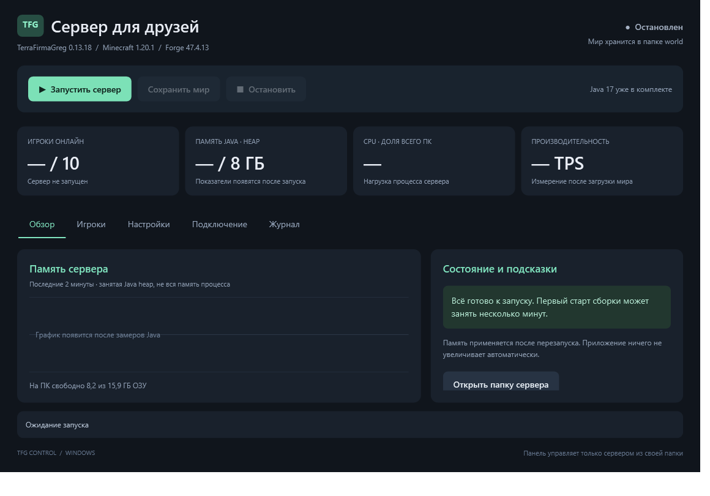

# TFG Control

Локальная панель управления сервером **TerraFirmaGreg-Modern 0.13.18** для Windows 10/11 x64.



## Скачать

Откройте [последний релиз](https://github.com/genchironone-wq/TFG-Control/releases/latest).

- `TerraFirmaGreg-0.13.18-Control-Windows.zip` — готовый сервер, Java 17 и панель. Распакуйте весь архив в новую папку и запустите `TFG-Control.exe`.
- `TFG-Control.exe` — только панель для уже подготовленной папки сервера. Положите рядом с `java17`, `libraries`, `mods` и `user_jvm_args.txt`.
- Файл `.sha256` позволяет проверить целостность полного архива.

При первом запуске хост самостоятельно читает и принимает соглашение Minecraft. В комплекте оно не принято заранее.

## Возможности

- Запуск и штатная остановка без консольного окна.
- Кнопка сохранения мира.
- Выбор лимита ОЗУ и числа мест при остановленном сервере; по умолчанию 8 ГБ.
- Игроки онлайн и список ников.
- Память Java heap, график, память процесса в ОЗУ, CPU, TPS и время тика.
- Подсказки при длительном заполнении heap, недостатке системной памяти и падении TPS.
- Список адресов сетевых адаптеров и копирование адреса для подключения.
- Журнал и защита от запуска второй копии панели для той же папки.

Панель не вычисляет потребность в памяти только по числу игроков и не увеличивает её автоматически. Изменение лимита применяется после перезапуска. Недоступные или устаревшие метрики показываются прочерком.

## Подключение друзей

У всех должна быть **полная клиентская сборка TerraFirmaGreg-Modern 0.13.18**, Minecraft Java 1.20.1, Forge 47.4.13. Серверный архив не заменяет клиентскую сборку.

Хост подключается через `localhost:25565`. Друзья используют адрес хоста в общей закрытой сети. Панель не создаёт VPN, не открывает порты и не меняет брандмауэр. Наличие адреса в списке не гарантирует доступность извне.

Готовый комплект настроен с `online-mode=false` для игроков без проверки лицензии и лицензионных аккаунтов. Владельцы ников не проверяются: используйте только закрытую сеть знакомых, не выставляйте такой сервер в открытый интернет. У всех должны быть уникальные постоянные ники. Для лицензионного сервера включите `online-mode=true` и `enforce-secure-profile=true` после остановки.

Подробнее: [инструкция на русском](docs/guide-ru.txt).

## Сборка приложения

Нужны Windows x64 и .NET Framework 4.x с WPF. Сторонние NuGet-пакеты не используются.

```powershell
& .\src\build.ps1
```

Результат: `src/TFG-Control.exe`.

```powershell
Start-Process .\src\TFG-Control.exe -ArgumentList '--self-test',"$PWD\self-test.txt" -Wait
Get-Content .\self-test.txt
```

Тесты проверяют готовность сервера, синхронизацию игроков, вход/выход, TPS, парсинг heap и различение нехватки ОЗУ от общей перегрузки. Управление дочерним процессом дополнительно проверено на тестовом Java-заменителе (`tests/MockJava.cs`), включая штатную остановку и сохранение JVM-флагов.

Реальный сервер проверен до запроса EULA. Работа сети и нагрузка на компьютере будущего хоста не проверены.

## Происхождение компонентов

Это неофициальная панель; она не связана с разработчиками Minecraft или TerraFirmaGreg.

- [Официальный релиз TerraFirmaGreg-Modern 0.13.18](https://github.com/TerraFirmaGreg-Team/Modpack-Modern/releases/tag/0.13.18).
- Java: Microsoft OpenJDK 17; исходные уведомления и лицензии находятся в `java17/legal` готового комплекта.
- Права и лицензии на моды, Forge, Java и остальные сторонние компоненты сохраняются у их авторов.

В репозитории находятся исходники панели и документация. Большой серверный архив распространяется отдельно как asset релиза. Миры, игровые логи, персональные настройки и данные авторизации в репозиторий не входят.
